

# ⚜️ منصة الأشبال الذكية — نسخة تجريبية

منصة كشفية رقمية عربية لقادة الكشافة والأشبال وأولياء أمورهم: متابعة الأشبال، وتقييمهم، ورحلة تأهيل تفاعلية، وألعاب ومسابقات تعليمية، وركن للحماية من الأذى.

## 🔗 جرّبها الآن

**[افتح النسخة التجريبية](https://mohamed6489.github.io/cub-scouts-demo/)**

> هذه نسخة تجريبية تعمل بالكامل داخل المتصفح **ببيانات وهمية**. لا تتصل بأي قاعدة بيانات حقيقية، ولا تحتوي على بيانات أطفال حقيقيين. أي تعديل تجريه يبقى في صفحتك فقط، ويمكنك إرجاع البيانات بزر «إعادة البيانات التجريبية».

من الشريط العلوي اختر **«عرض الحساب»** لتجربة المنصة بعيون كل مستخدم: المشرف العام، مسؤول الموقع، القائد، ولي الأمر، الشبل.

## ✨ أبرز المميزات

- 🗺️ **أكيلا – رحلة الشبل نحو القمة**: رحلة تأهيل مدتها 24 شهرًا عبر 8 جزر، بتحديات يعتمدها القائد ونقاط خبرة وشارات.
- 🎯 **مسابقات بثلاثة مستويات** (سهل، متوسط، صعب) و225 سؤالًا، مع مؤقت وحفظ للتقدم.
- 🌱 **أبطال التنمية المستدامة**: الأهداف الـ17 بهويتها البصرية الرسمية، ولعبة كروت بثلاثة مستويات.
- 📋 **التقييم**: تقييم يومي وأسبوعي، وتقرير شهري، وتقييم شامل بالنجوم، وتقييم مستقل للقادة.
- 🏆 **سجل شرف المتصدرين**: ترتيب الأشبال والسداسيات بالأسبوع والشهر والعام من النقاط المعتمدة فقط.
- ⚜️ **وعد وقانون الأشبال**، و🪢 **مهارات الحبال**، و🎒 **حقيبة المغامرة**، و♟️ **مملكة الشطرنج**.
- 🛡️ **ركن الحماية من الأذى**: البلاغات، والتحديات التوعوية، والدليل.
- 🎖️ **أوسمة ودروع القادة** مع سجل منح وإلغاء كامل.

## 📸 لقطات

| خريطة أكيلا | المسابقات |
|---|---|
|  |  |
| **أهداف التنمية المستدامة** | **لوحة القائد** |
|  |  |

## 📱 من الموبايل

المنصة مصممة للهاتف أولًا. هذه لقطات من النسخة التجريبية على شاشة موبايل:

<table>
<tr>
<td align="center">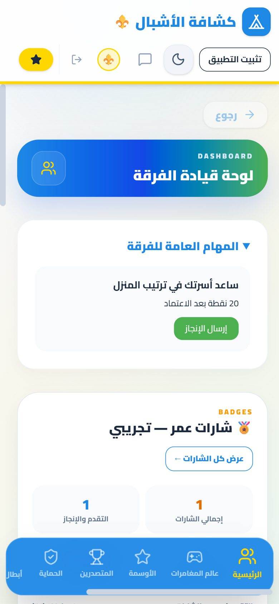 <b>الصفحة الرئيسية للشبل</b></td>
<td align="center">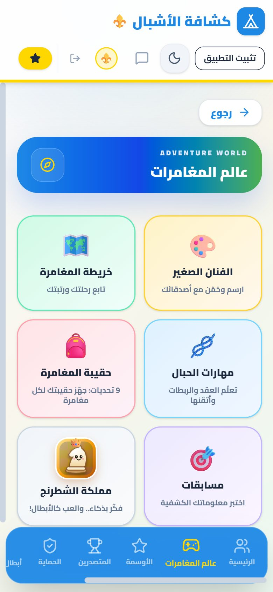 <b>عالم المغامرات</b></td>
<td align="center">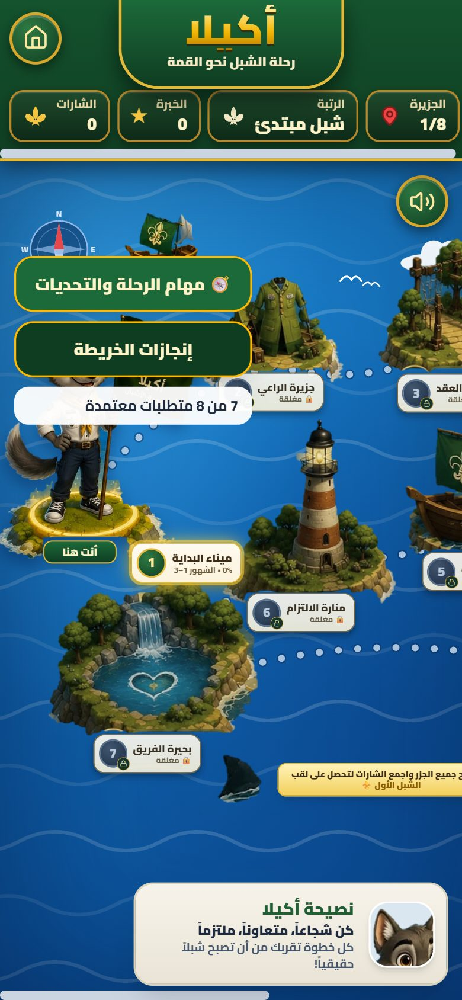 <b>خريطة أكيلا: 8 جزر</b></td>
</tr>
<tr>
<td align="center">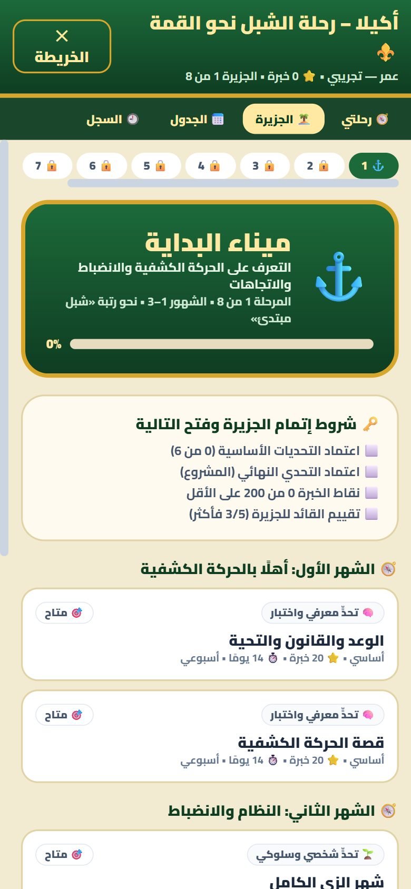 <b>تحديات الجزيرة</b></td>
<td align="center">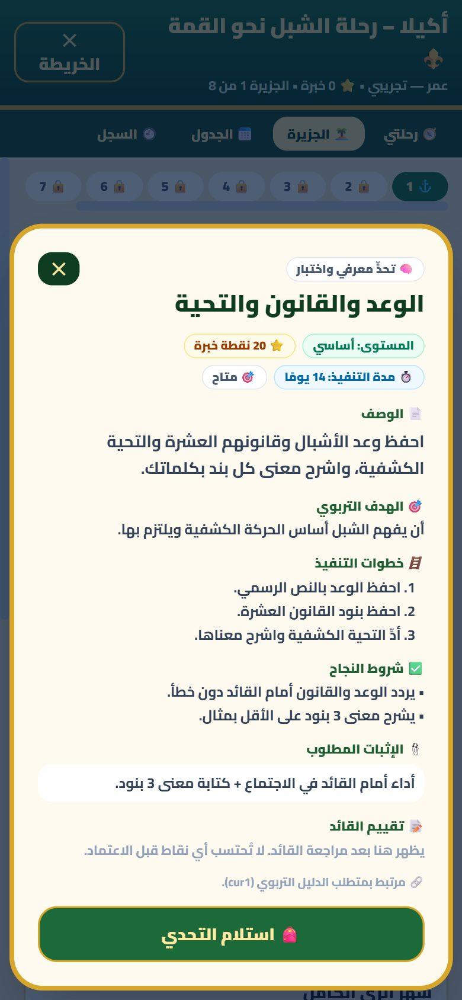 <b>بطاقة تحدٍّ يعتمدها القائد</b></td>
<td align="center">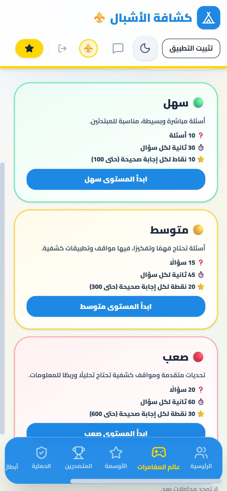 <b>مستويات المسابقات</b></td>
</tr>
<tr>
<td align="center">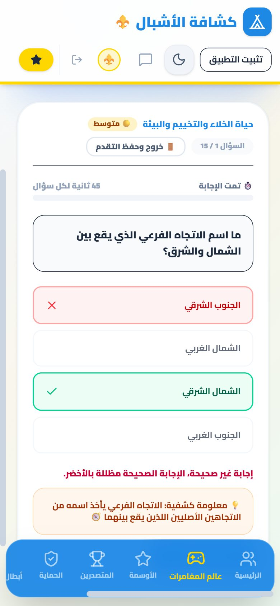 <b>سؤال بمؤقت ومعلومة كشفية</b></td>
<td align="center">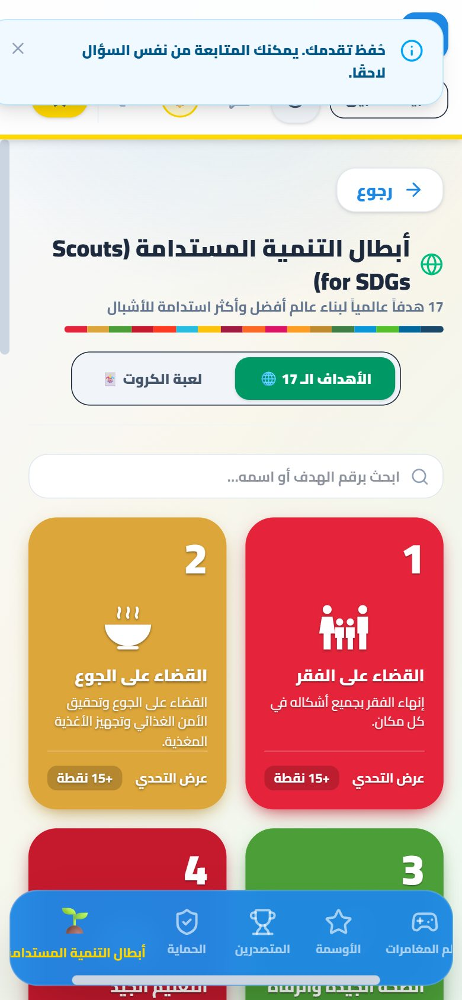 <b>الأهداف الـ17 بألوانها الرسمية</b></td>
<td align="center">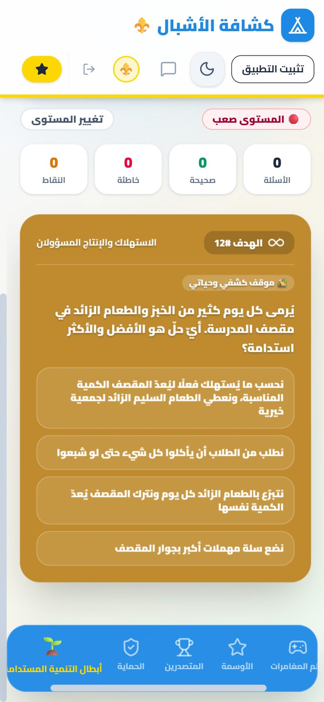 <b>لعبة كروت أبطال التنمية</b></td>
</tr>
<tr>
<td align="center">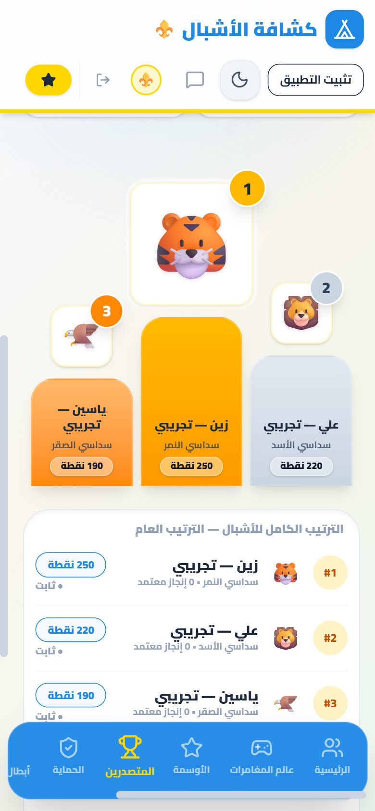 <b>سجل شرف المتصدرين</b></td>
<td align="center">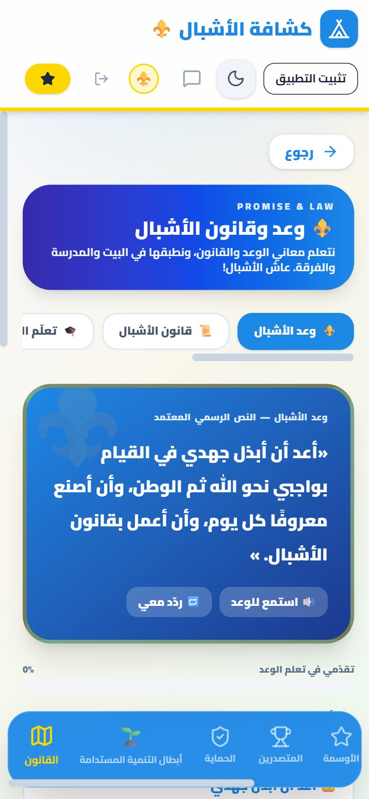 <b>وعد وقانون الأشبال</b></td>
<td align="center">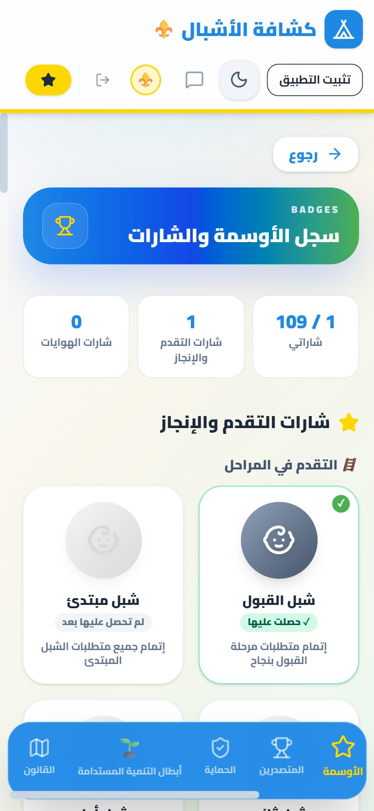 <b>الأوسمة والشارات</b></td>
</tr>
<tr>
<td align="center">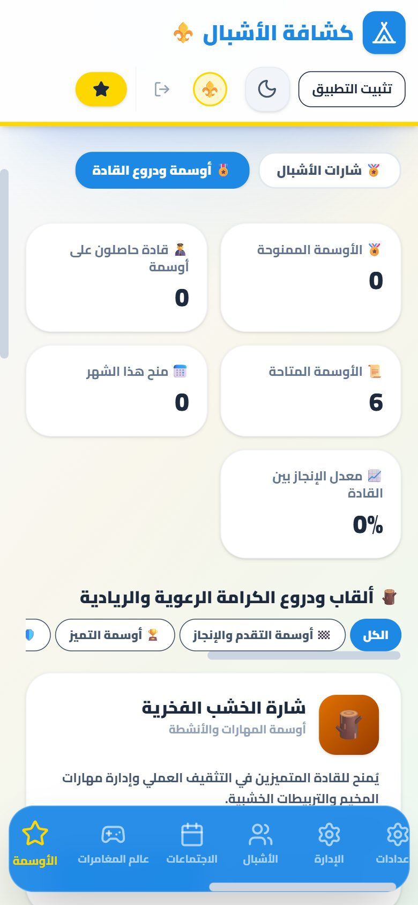 <b>أوسمة ودروع القادة</b></td>
<td align="center">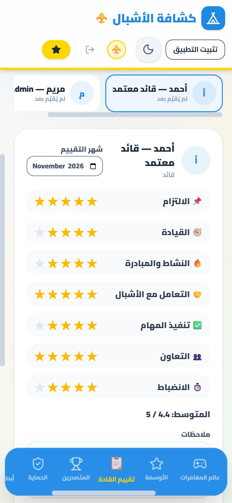 <b>تقييم القادة</b></td>
<td></td>
</tr>
</table>

## 🛠️ التقنيات

React 19 • TypeScript • Vite • Tailwind CSS • Firebase (Auth + Firestore) في النسخة الحقيقية • PWA

---

# ⚜️ Smart Cubs Platform — Live Demo

An Arabic (RTL) digital platform for cub scout leaders, cubs and parents: cub tracking and evaluation, an interactive qualification journey, educational games and quizzes, and a safeguarding corner.

**[▶ Open the demo](https://mohamed6489.github.io/cub-scouts-demo/)** — runs entirely in the browser with **fake data**; no real database or children's data. Use **«عرض الحساب»** in the top bar to switch between Super Admin, Admin, Leader, Parent and Cub views.

Built with React 19, TypeScript, Vite and Tailwind CSS (Firebase Auth + Firestore in production).
